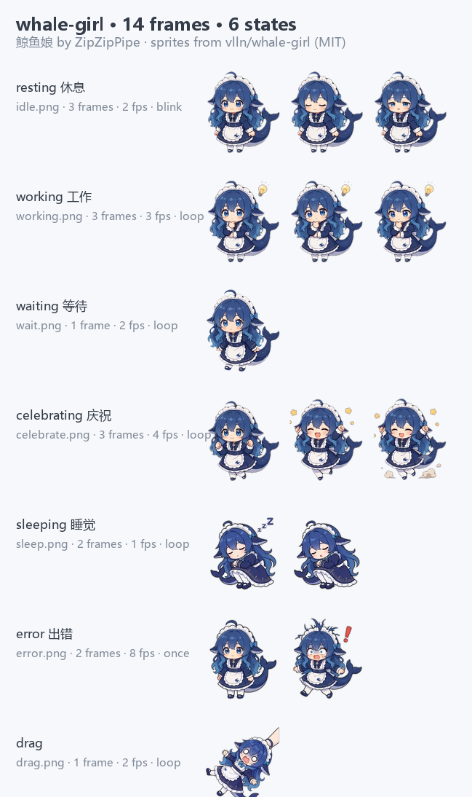

# Whale Girl

**Your little whale buddy for work, wins, and well-earned naps.**



*Character state overview. 鲸鱼娘 by [ZipZipPipe](https://space.bilibili.com/4168597), sprites from [vlln/whale-girl](https://github.com/vlln/whale-girl) (MIT).*

A little companion that lives inside your DeepSeek Harness (DSH) window—there while you work, wait, and rest.

一只住在 DSH 窗口里的鲸鱼娘。陪你工作、等你决定，也陪你好好打个盹。

**Current release 0.1.0** — the plugin carries the whale-girl name end to end: package `dsh-plugin-whale-girl`, entry ID `whale-girl`, English card "Whale Girl". The whale-girl art, the session switcher, and the stretchy drag pose are in; the pomodoro and the gentle-animations switch were removed by design. See the [release notes](CHANGELOG.md), the [upgrade notes](UPGRADE.md), and the [compatibility notes](COMPATIBILITY.md).

## Features

- Drag, resize, hide, and restore your whale inside the DSH window.
- Open the session list from the whale and jump straight to any session.
- Choose **All sessions** or **Current session**, with a working-session count drawn just above the working pose's light bulb (above the character's frame, so it never covers the art).
- Seven animated character states (resting, working, waiting, celebrating, sleeping, error, plus the upstream drag pose held while the whale is carried), each drawn frame by frame from the whale-girl sprite set.
- A custom icon in the DSH plugin manager: the whale-girl waiting frame itself as `assets/icon.png`, scaled onto a rounded light plate — the shipped artwork, not a redraw.
- English and Chinese text, light and dark settings menus; the whale always animates, regardless of the OS reduced-motion setting.
- Separate normal completion from cancellation and failure; a falling working count or green unread indicator alone does not mean success.

This is an in-window plugin, not a separate operating-system desktop overlay.

## Install

### 1. Build a package from this checkout

```sh
pnpm install --frozen-lockfile
pnpm run build
pnpm test
npm pack --ignore-scripts --pack-destination dist
```

Then enter the absolute path of the generated `dist/dsh-plugin-whale-girl-<version>.tgz` in DSH's plugin installation interface.

### 2. Install straight from Git

Prebuilt plugin files are committed, so DSH can install a commit or tag without building anything:

```text
github:esters18443/dsh-plugin-whale-girl#<commit-or-tag>
```

Upgrading from the earlier public 0.2.x line? Read the [upgrade notes](UPGRADE.md) first: overrides for the old entry ID do not migrate automatically. Do not replace the plugin or restart DSH while tasks are running. This plugin never automatically edits your profile.

After an update that changes Host or client modules, wait for current tasks to finish, fully quit DSH, and reopen it. Closing a window may not quit the application.

## Usage

- **Click** the whale to open the session list, then pick a row to jump to that session; **drag** it to reposition.
- Type in the list's filter box to narrow rows by title or Workspace. Sessions that need you or are running lead the list, then the most recently updated; the current session is marked. Hovering either edge of the list shows a resize cursor, and dragging it changes the width (280–520px, remembered locally).
- **Right-click** to change session scope, size, and nap timing.
- Use the restore button to bring back a hidden whale.
- Global scope covers ordinary main sessions on the currently connected Host—not multiple devices or Hosts.
- Waiting for user input has higher display priority. Brief completion notices are not queued for later replay.

## Compatibility and behavior

- Originally developed for **DSH Desktop 0.1.6-alpha.2 on macOS arm64**. DSH is still evolving; other version/platform combinations are not universally certified.
- The completion fix was checked against real DSH Gateway/Cordis modules, and the user confirmed celebration in the installed app. This does not claim exhaustive live testing of every concurrent-session, reconnect, cancellation or upgrade scenario.
- From 0.2.0 the module is `dsh-plugin-whale-girl` and the entry ID is `whale-girl`. Earlier installs used `whale-pet` (since public 0.2.7) or `dsh-plugin-whale-pet` (0.2.6 and earlier) — both are legacy IDs that require migration; see the [upgrade notes](UPGRADE.md).
- Completion uses live normal turn-end events. Intermediate assistant/tool messages, cancellation, disconnected history and work-count changes are not treated as successful completion.
- The offline preview simulates completion; it validates rendering, not delivery of live DSH events.

When reporting an issue in this repository, include DSH/plugin versions, session scope, and reproduction steps. Remove chat content, session identifiers, and other sensitive information.

## Development and local preview

Use Node.js 22 or newer and the pnpm version pinned in the project manifest.

```sh
pnpm install --frozen-lockfile
pnpm run build
pnpm test
```

The build regenerates the bridge contract and client, then creates an offline preview. Open this generated local file in a browser; no web server is needed:

```text
preview/index.html
```

The preview does not connect to DSH or call a model. Its generic chevron is independently drawn; the production interface uses DSH's public icon component.

```sh
# After a successful build and test run, create a local plugin package:
npm pack --ignore-scripts --pack-destination dist
```

The package declares no installation lifecycle hooks to build code, migrate profiles, or download a runtime. Building and testing are explicit development steps. Prebuilt files are committed for Git installation; rebuild after source changes and commit matching outputs.

Fonts are bundled, so ordinary builds do not download them. New Chinese bubble text requires a glyph-coverage check; the font-resubsetting tools are not included in this repository. See [font sources and licenses](FONT-LICENSES.md).

The character art is sliced from the pinned whale-girl commit rather than edited by hand. `python tools/prepare-whale-girl.py` re-downloads that commit, re-slices all fifteen frames with one shared crop box, rewrites `assets/sprites/manifest.json` and prints the total size; add `--colors 256` for a palette build roughly five times smaller. `tools/build.mjs` validates each PNG, the frame counts and the size budget, then inlines the frames into the bundle.

## Privacy and runtime boundaries

- Does not modify DSH itself, send model messages, add model inference calls, or act on approvals for you.
- Uses DSH's existing authenticated connection. No additional listening port, telemetry, or runtime font/CDN requests.
- The completion bridge projects only necessary session identity and turn-boundary metadata—not chat content.
- Preferences stay in client-local storage. No runtime diagnostic report, diagnostic counters or diagnostic query endpoint is included in this release.
- Tests use synthetic data. This repository contains no user profiles, session records, or extracted DSH implementation code.

## Artwork and project notice

The character is **鲸鱼娘** (whale-girl), created by [ZipZipPipe](https://space.bilibili.com/4168597). The sprites come from the MIT-licensed project [vlln/whale-girl](https://github.com/vlln/whale-girl) (Copyright (c) 2026 Sam Gao), pinned to commit `4fe5792c6f873c6b3a29dd12198ba47a397e17f3`, sliced into single frames and re-compressed for this plugin. Details, exact changes and the reusable command are in the [asset credits](ASSETS-LICENSE.md).

This is a personal project, not an official DeepSeek product. It does not represent DeepSeek's official views or endorsement. It is also not an official plugin of the whale-girl project.

Keep the upstream MIT notice and the character credit when you redistribute the artwork or a package that embeds it.

- **Code:** [MIT License](LICENSE).
- **Character artwork:** [asset credits and license](ASSETS-LICENSE.md) — 鲸鱼娘 by ZipZipPipe, sprites from whale-girl under MIT.
- **Fonts:** [SIL OFL 1.1 and source notices](FONT-LICENSES.md).
- **Zod:** its MIT copyright and license notice are preserved in the generated bridge files.

The MIT licence covers this project's code and the sliced sprites; the character design itself still belongs to its author, so the credit travels with it.
